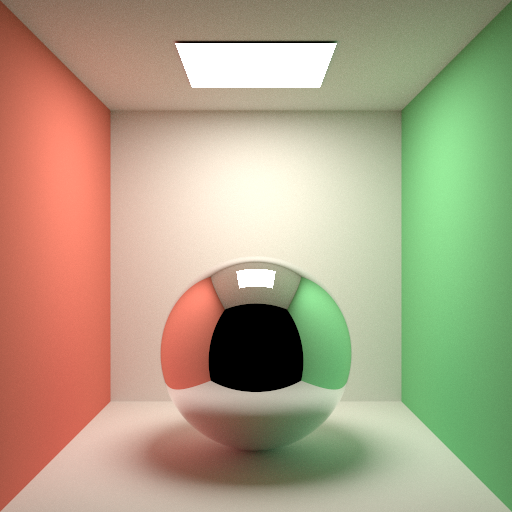

# Claude Opus 5 · Claude Code CLI



## Run details

| Field               | Value           |
| ------------------- | --------------- |
| Model               | Claude Opus 5   |
| Effort              | default         |
| Quant               | -               |
| Harness             | Claude Code CLI |
| Tokens              | -               |
| Context utilization | -               |
| Code produced       | ✅              |
| Binaries built      | ✅              |
| Image produced      | ✅              |
| Code correct        | -               |
| Scene correct       | ✅              |

## Run stats

```
Total cost: $0.69
Total duration (API): 2m 57s
Total duration (wall): 6m 8s
Total code changes: 323 lines added, 0 lines removed

claude-haiku-4-5: 601 input, 21 output, 0 cache read, 0 cache write ($0.0007)
claude-opus-5: 19 input, 13.5k output, 275.1k cache read, 21.1k cache write ($0.69)
```

## Notes

- Result was correctly produced in PPM format, only the submission was provided in png. Thanks to rychveldir for the run.
