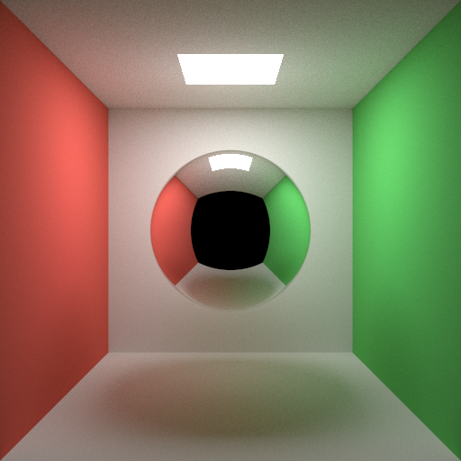

# Claude Opus 5 · Ultracode

## Run details

| Field               | Value         |
| ------------------- | ------------- |
| Model               | Claude Opus 5 |
| Effort              | default       |
| Quant               | -             |
| Harness             | Ultracode     |
| Tokens              | -             |
| Context utilization | -             |
| Code produced       | ✅            |
| Binaries built      | ✅            |
| Image produced      | ✅            |
| Code correct        | -             |
| Scene correct       | ✅            |

## Notes

- Arguably failed the "concisely-commented" requirement, Opus 5 feels verbose in general. Thanks to lycium for the run.
