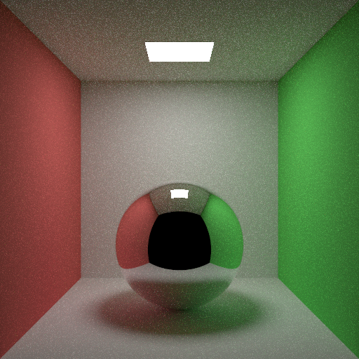

# Claude Opus 5.5 · Claude Code CLI



## Run details

| Field               | Value           |
| ------------------- | --------------- |
| Model               | Claude Opus 5.5 |
| Effort              | default         |
| Quant               | -               |
| Harness             | Claude Code CLI |
| Tokens              | -               |
| Context utilization | -               |
| Code produced       | ✅              |
| Binaries built      | ✅              |
| Image produced      | ✅              |
| Code correct        | -               |
| Scene correct       | ✅              |

## Run stats

```
Total cost:            $0.3231
Total duration (API):  1m 13s
Total code changes:    224 lines added, 0 lines removed
Usage by model:
    claude-haiku-4-5:  977 input, 16 output, 0 cache read, 0 cache write ($0.0011)
    claude-opus-5-5:   610 input, 6.8k output, 214.7k cache read, 17.5k cache write ($0.3220)
```

## Notes

- Thanks to rychveldir for the run.
