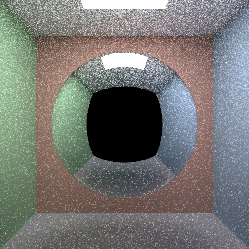

# Deepseek 4 Flash 0731 · pi (no extensions)



## Run details

| Field               | Value                                             |
| ------------------- | ------------------------------------------------- |
| Model               | Deepseek 4 Flash 0731                             |
| Effort              | high (`reasoning_effort` in chat-template-kwargs) |
| Quant               | UD-IQ2_XXS                                        |
| Harness             | pi (no extensions)                                |
| Tokens              | ↑57k ↓56k                                         |
| Context utilization | 93.8%/64k                                         |
| Code produced       | ✅                                                |
| Binaries built      | ✅                                                |
| Image produced      | ✅                                                |
| Code correct        | -                                                 |
| Scene correct       | ✅                                                |

## Inference config

Local model served by llama.cpp with default arguments plus:

```ini
reasoning = on
cache-type-k = q4_0
cache-type-v = q4_0
ctx-size = 64000
temperature = 1.0
top-p = 0.95
chat-template-kwargs = {"reasoning_effort": "high"}
```

## Notes

- Due to hardware limits I had to run this with heavily quantized weights and kv-cache, and also a small context size (but no context compression was needed).
- The results were produced after `[↑38k ↓39k]` tokens, then the agent proceeded to verify the resulting image which turned into a sort of thinking loop.
- The png file is a byproduct, not sure why the agent converted the ppm.
