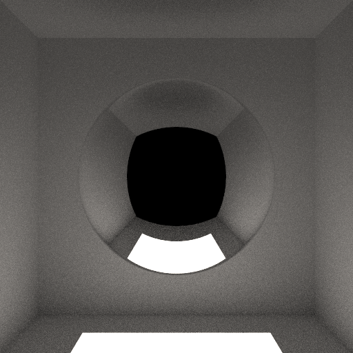

# Hy3 (295B-A21B) · pi (no extensions)



## Run details

| Field               | Value                                            |
| ------------------- | ------------------------------------------------ |
| Model               | Hy3 (295B-A21B)                                  |
| Effort              | low (`reasoning_effort` in chat-template-kwargs) |
| Quant               | IQ1_M                                            |
| Harness             | pi (no extensions)                               |
| Tokens              | -                                                |
| Context utilization | 64k                                              |
| Code produced       | ✅                                               |
| Binaries built      | ✅                                               |
| Image produced      | ✅                                               |
| Code correct        | -                                                |
| Scene correct       | ❌                                               |

## Inference config

Local model served by llama.cpp with default arguments plus:

```ini
cache-type-k = q4_0
cache-type-v = q4_0
ctkd = q4_0
ctvd = q4_0
ctx-size = 64000
chat-template-kwargs = {"reasoning_effort": "low"}
```

## Notes

- Due to hardware limits I had to run this with Q1 quantization and also very limited context size, so there were multiple context compressions during the run.
- The agent also wrote `check.js`, a node script that samples the rendered PPM (mean/min/max plus pixels at center, ceiling, floor and both walls).
