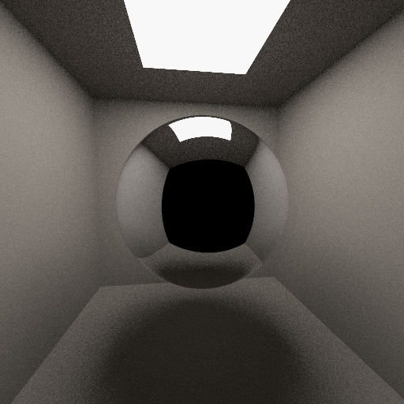

# Qwen3.6-27B · pi (no extensions)



## Run details

| Field               | Value              |
| ------------------- | ------------------ |
| Model               | Qwen3.6-27B        |
| Effort              | default            |
| Quant               | UD-Q8_K_XL         |
| Harness             | pi (no extensions) |
| Tokens              | ↑15k ↓52k          |
| Context utilization | 26.1%/256k         |
| Code produced       | ✅                 |
| Binaries built      | ✅                 |
| Image produced      | ✅                 |
| Code correct        | -                  |
| Scene correct       | ✅                 |

## Inference config

Local model served by llama.cpp with default arguments plus the recommended coding params:

```ini
temperature = 0.6
top-p = 0.95
top-k = 20
min-p = 0.0
presence-penalty = 0.0
chat-template-kwargs = {"preserve_thinking": true, "reasoning_preserve": true}
```

## Notes

- The agent created a by-product file named `nul`, I renamed it to `nul_` to be able to commit full output.
