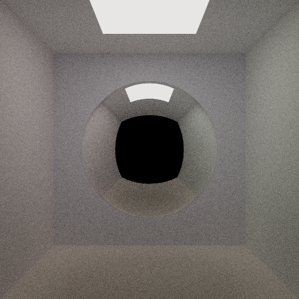

# Qwen3.8-27B (low) · DeepSeek Harness (default plugins)



## Run details

| Field               | Value                                            |
| ------------------- | ------------------------------------------------ |
| Model               | Qwen3.8-27B                                      |
| Effort              | low (`reasoning_effort` in chat-template-kwargs) |
| Quant               | UD-Q8_K_XL                                       |
| Harness             | DeepSeek Harness (default plugins)               |
| Tokens              | ↑2.8m ↓95.6k                                     |
| Context utilization | 37.3%/256k                                       |
| Code produced       | ✅                                               |
| Binaries built      | ✅                                               |
| Image produced      | ✅                                               |
| Code correct        | -                                                |
| Scene correct       | ✅                                               |

## Inference config

Local model served by llama.cpp with default arguments plus:

```ini
temperature = 1.0
top-p = 0.95
top-k = 20
min-p = 0.0
presence-penalty = 0.0
chat-template-kwargs = {"preserve_thinking": true, "reasoning_preserve": true, "reasoning_effort": "low"}
```

## Notes

- Input token count is very big, I think dsh is counting that in a different way. In the thinking traces I didn't see much difference compared to the pi run.
- The agent also left an `output.png` next to the ppm.
