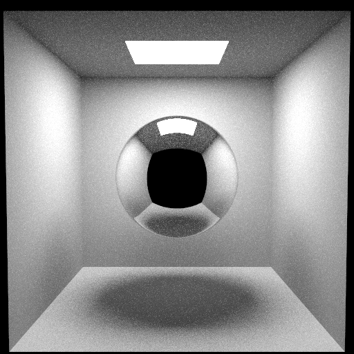

# Qwen3.8-27B (low) · pi (no extensions)



## Run details

| Field               | Value                                                                        |
| ------------------- | ---------------------------------------------------------------------------- |
| Model               | Qwen3.8-27B                                                                  |
| Effort              | low (set in the pi harness, also `reasoning_effort` in chat-template-kwargs) |
| Quant               | UD-Q8_K_XL                                                                   |
| Harness             | pi (no extensions)                                                           |
| Tokens              | ↑17k ↓47k                                                                    |
| Context utilization | 25.2%/256k                                                                   |
| Code produced       | ✅                                                                           |
| Binaries built      | ✅                                                                           |
| Image produced      | ✅                                                                           |
| Code correct        | -                                                                            |
| Scene correct       | ✅                                                                           |

## Inference config

Local model served by llama.cpp with default arguments plus:

```ini
temperature = 1.0
top-p = 0.95
top-k = 20
min-p = 0.0
presence-penalty = 0.0
chat-template-kwargs = {"preserve_thinking": true, "reasoning_preserve": true, "reasoning_effort": "low"}
```

Pi harness effort: low

## Notes

- Agent created a temporary debugger cpp script and used ffmpeg on path to convert ppm to png for visual verification.
