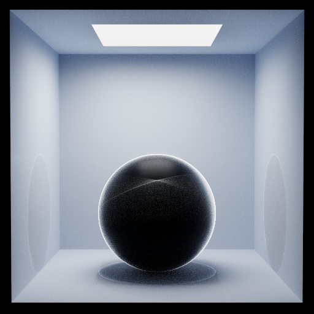

# Qwen3.8-27B (high) · pi (no extensions)



## Run details

| Field               | Value                        |
| ------------------- | ---------------------------- |
| Model               | Qwen3.8-27B                  |
| Effort              | high (set in the pi harness) |
| Quant               | UD-Q8_K_XL                   |
| Harness             | pi (no extensions)           |
| Tokens              | ↑75k ↓149k                   |
| Context utilization | 63.6%/256k                   |
| Code produced       | ✅                           |
| Binaries built      | ✅                           |
| Image produced      | ✅                           |
| Code correct        | -                            |
| Scene correct       | ✅                           |

## Inference config

Local model served by llama.cpp with default arguments plus:

```ini
temperature = 1.0
top-p = 0.95
top-k = 20
min-p = 0.0
presence-penalty = 0.0
chat-template-kwargs = {"preserve_thinking": true, "reasoning_preserve": true}
```

Pi harness effort: high

## Notes

- Agent created a temporary debugger cpp script and used ffmpeg on path to convert ppm to png for visual verification, that png is kept as `verify.png`.
