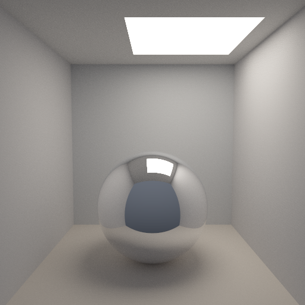

# Qwen3.8-Flash-Next (gufo) · pi (no extensions)

## Run details

| Field               | Value                      |
| ------------------- | -------------------------- |
| Model               | Qwen3.8-Flash-Next         |
| Effort              | max (requested, see notes) |
| Quant               | UD-Q4_K_XL                 |
| Harness             | pi (no extensions)         |
| Tokens              | ↑20k ↓28k                  |
| Context utilization | 13.3%/262k                 |
| Code produced       | ✅                         |
| Binaries built      | ✅                         |
| Image produced      | ✅                         |
| Code correct        | -                          |
| Scene correct       | ✅                         |

## Inference config

Served by gufo instead of llama.cpp. No explicit sampling params were set beyond the "max" thinking level in pi, see notes.

## Notes

- We're trying out gufo instead of llama.cpp for inference on strix halo, it's very fast.
- "max" thinking level, but the token usage is suspiciously low, possibly this setting was ignored by gufo?
- Thanks to lycium for the run.
